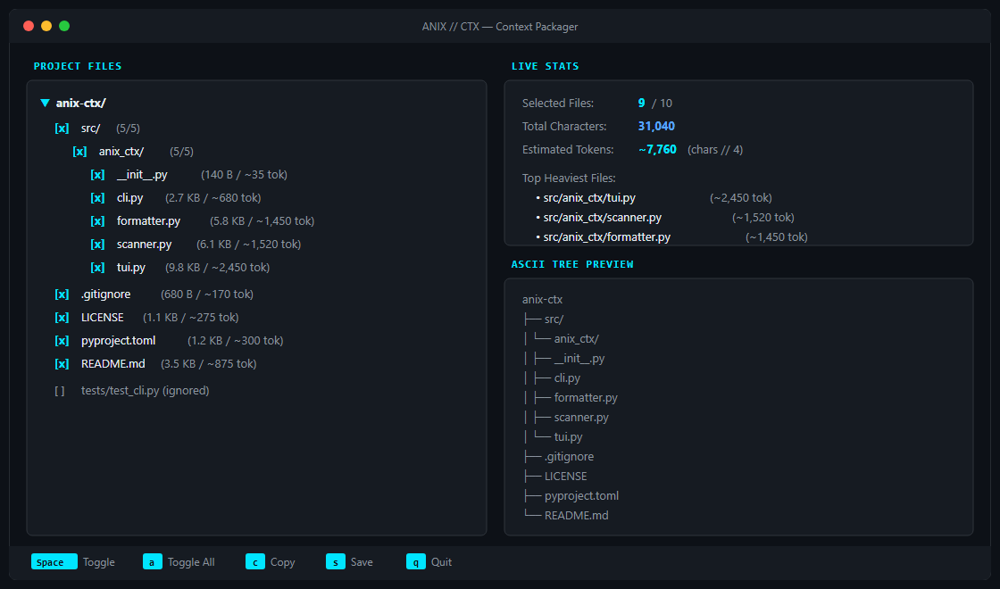

# ANIX CTX

  [](https://pypi.org/project/anix-ctx/) 

🇷🇺 Русский · 🇬🇧 [English](README.md)

Интерактивный консольный упаковщик контекста проекта для LLM (Claude, ChatGPT, Gemini). Позволяет визуально выбирать нужные файлы через TUI, отслеживать расход токенов в реальном времени и копировать готовый Markdown с ASCII-деревом прямо в буфер обмена.

<p align="center">
  
</p>

```
$ anix-ctx . --copy
[ANIX CTX] Copied 8 files (~8,690 tokens, 34,770 chars) to clipboard!
```

---

## Возможности

- **TUI-навигатор файлов:** дерево проекта с переключением чекбоксов через `Space` (для отдельных файлов или целых каталогов).
- **Парсер .gitignore:** автоматическое исключение `.git`, `node_modules`, `__pycache__`, виртуальных окружений, лок-файлов (`package-lock.json`, `poetry.lock`, `uv.lock`), минифицированных ассетов и правил из локальных `.gitignore`.
- **Защита от бинарников и лимит размера:** автоматический отсев бинарных файлов и пропуск файлов больше 500 КБ для экономии контекста модели.
- **Кэширование в памяти:** размеры файлов и количество символов рассчитываются один раз при сканировании; переключение файлов не производит лишних чтений с диска.
- **Динамический Markdown fence:** адаптивная длина обратных кавычек (минимум 4) исключает поломку разметки при наличии внутренних блоков кода.
- **Headless-режим:** флаги CLI (`--copy`, `-o context.md`) для использования в скриптах и автоматизациях без открытия интерфейса.
- **Безопасная кодировка:** чтение файлов через UTF-8 с автоматической заменой поврежденных символов для стабильной работы на Windows.

---

## Установка

Требуется Python 3.10+.

```bash
pip install anix-ctx
```

Или в режиме разработки:

```bash
git clone https://github.com/an1zy/anix-ctx.git
cd anix-ctx
pip install -e .
```

---

## Использование

### Интерактивный TUI

Запуск в текущей директории:

```bash
anix-ctx
```

Или с указанием конкретной папки:

```bash
anix-ctx /path/to/project
```

### Быстрый режим (без интерфейса)

Упаковка файлов без открытия TUI:

```bash
# Копирование напрямую в буфер обмена
anix-ctx --copy
anix-ctx -c

# Сохранение в файл
anix-ctx -o context.md

# Упаковка конкретной подпапки сразу в буфер
anix-ctx src/ --copy
```

---

## Горячие клавиши

| Клавиша | Действие |
| :--- | :--- |
| `Space` | Переключить выбор текущего файла или всей папки |
| `Enter` / Клик | Раскрыть/свернуть каталог или переключить файл |
| `a` | Выбрать все / Снять выбор со всех файлов |
| `c` | Скопировать Markdown-контекст в буфер обмена |
| `s` | Сохранить контекст в `context.md` |
| `q` | Выйти из программы |

---

## Формат вывода

Сформированный контекст содержит ASCII-дерево выбранных файлов и блоки исходного кода с автоматическим определением синтаксиса:

````markdown
# Project Context

## File Tree
````
anix-ctx
├── src/
│   └── anix_ctx/
│       ├── __init__.py
│       ├── cli.py
│       ├── formatter.py
│       ├── scanner.py
│       └── tui.py
├── .gitignore
├── LICENSE
├── pyproject.toml
└── README.md
````

## Files

### `pyproject.toml`
````toml
[build-system]
requires = ["hatchling"]
build-backend = "hatchling.build"
...
````

### `src/anix_ctx/cli.py`
````python
...
````
````

---

## Часть экосистемы ANIX

- **[anixcode](https://github.com/an1zy/anixcode)** — терминальный AI-агент для разработки.
- **[anix-type](https://github.com/an1zy/anix-type)** — контекстный автокомплит и генератор команд для терминала.
- **[anix-vault](https://github.com/an1zy/anix-vault)** — локальный менеджер секретов и переменных окружения.
- **[anix-snap](https://github.com/an1zy/anix-snap)** — генератор красивых скриншотов кода из консоли.

---

## Лицензия

MIT License. Copyright (c) 2026 ANIX.
